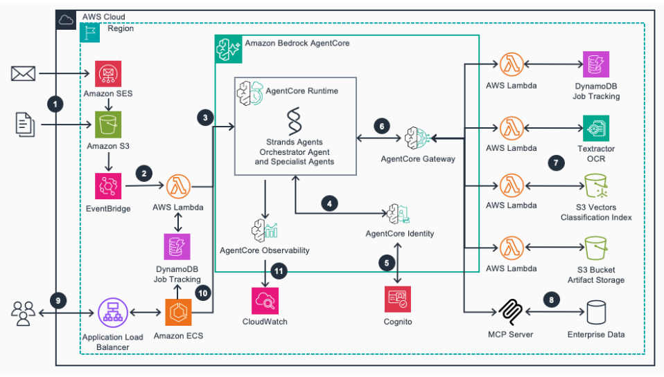

# Self-improving document processing with Amazon Bedrock AgentCore

**Posted on:** AWS Study Group VN (Facebook) – 06/11/2026

*Figure: Architecture of the self-improving document processing solution with Amazon Bedrock AgentCore. Source: AWS Machine Learning Blog.*

Traditional document processing usually needs templates, extraction rules and validation logic written for every document type. When a vendor changes an invoice layout, the system breaks, and old mistakes repeat because the system does not remember what was corrected before.

AWS presents a sample solution that tackles this with **AI agents** on **Amazon Bedrock AgentCore**. Main components:

- **Amazon Textract**: extracts text from documents
- **Strands Agents**: open source SDK used to build the agent workflows
- **S3 Vectors**: stores **embeddings** (vectors that represent the meaning of text) to find similar documents
- **EventBridge + Lambda**: receive documents (by email or S3 upload) and create a processing job
- **Amazon Bedrock**: provides the Amazon Nova and Anthropic Claude models

The solution has 8 agents working together in **workflows**:

1. **Identification**: finds the document type and sender, then looks for similar documents
2. **Training**: generates extraction prompts, validates the result, fixes the prompts on failure and saves them
3. **Automation**: for known document types, reuses the saved instructions to extract data

The key idea is that learned instructions are reused later. In the post's example, a repeated purchase order took 1 minute 30 seconds, compared with 3 minutes 49 seconds the first time. The estimated cost is about USD 58 per month for 10 training runs and 1,000 documents (US East).

**Notes from the article:**

- The example uses synthetic data and a mock ERP, so real use needs your own schemas, validators and prompts
- The timings come from a single run and are not a benchmark
- Cost is mostly model inference (about 85%)
- **Amazon Bedrock Guardrails** is recommended for sensitive documents

My takeaway: document processing is no longer just OCR followed by an LLM call. Agents can also learn from earlier corrections.

**Source:** *Build self-improving document processing using Amazon Bedrock AgentCore* – AWS Machine Learning Blog (14/10/2026)
<https://aws.amazon.com/blogs/machine-learning/build-self-improving-document-processing-using-amazon-bedrock-agentcore/>
