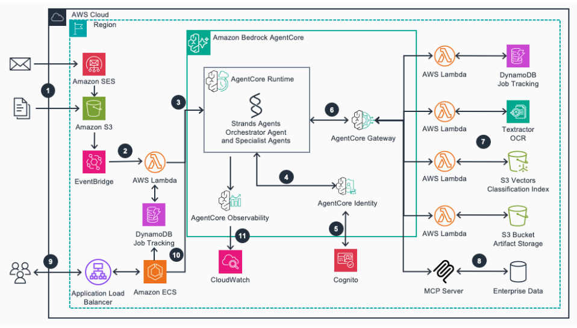

# Xử lý tài liệu tự cải thiện với Amazon Bedrock AgentCore

**Đăng trên:** AWS Study Group VN (Facebook) – 06/11/2026

*Hình: Kiến trúc giải pháp xử lý tài liệu tự cải thiện với Amazon Bedrock AgentCore. Nguồn: AWS Machine Learning Blog.*

Các hệ thống xử lý tài liệu truyền thống thường phải viết sẵn template, quy tắc trích xuất và logic kiểm tra cho từng loại tài liệu. Chỉ cần nhà cung cấp đổi bố cục hóa đơn là hệ thống hỏng, và những lỗi cũ vẫn lặp lại vì hệ thống không nhớ những gì đã được sửa.

AWS giới thiệu một giải pháp mẫu giải quyết vấn đề này bằng **AI agent (tác tử AI)** trên **Amazon Bedrock AgentCore**. Các thành phần chính:

- **Amazon Textract**: trích xuất chữ từ tài liệu
- **Strands Agents**: SDK mã nguồn mở để xây workflow cho các agent
- **S3 Vectors**: lưu **embedding (vector biểu diễn ý nghĩa của văn bản)** để tìm tài liệu tương tự
- **EventBridge + Lambda**: nhận tài liệu (qua email hoặc upload S3) và tạo job xử lý
- **Amazon Bedrock**: cung cấp mô hình Amazon Nova và Anthropic Claude

Giải pháp có 8 agent phối hợp trong các **workflow (luồng xử lý)**:

1. **Identification (nhận diện)**: xác định loại tài liệu và người gửi, rồi tìm tài liệu tương tự
2. **Training (học loại mới)**: tự sinh prompt trích xuất, kiểm tra kết quả, sửa prompt nếu lỗi rồi lưu lại
3. **Automation (xử lý tự động)**: với loại tài liệu đã biết, dùng lại hướng dẫn đã lưu để trích xuất

Điểm hay là hướng dẫn đã học được dùng lại cho các lần sau. Trong ví dụ của bài, một đơn đặt hàng lặp lại chạy mất 1 phút 30 giây, so với 3 phút 49 giây ở lần đầu. Chi phí ước tính khoảng 58 USD/tháng cho 10 lần training và 1.000 tài liệu (khu vực US East).

**Lưu ý từ bài viết:**

- Ví dụ dùng dữ liệu giả lập và một ERP giả, nên khi dùng thật phải tự thiết kế schema, validator và prompt
- Số liệu thời gian chỉ là một lần chạy minh họa, không phải benchmark (đo hiệu năng chuẩn)
- Chi phí chủ yếu nằm ở việc gọi mô hình (khoảng 85%)
- Nên dùng **Bedrock Guardrails (rào chắn an toàn)** với tài liệu nhạy cảm

Mình đọc bài này để hiểu hướng đi mới: xử lý tài liệu không chỉ là OCR rồi gọi LLM, mà còn có agent biết học từ lần sửa trước.

**Nguồn:** *Build self-improving document processing using Amazon Bedrock AgentCore* – AWS Machine Learning Blog (14/10/2026)
<https://aws.amazon.com/blogs/machine-learning/build-self-improving-document-processing-using-amazon-bedrock-agentcore/>
