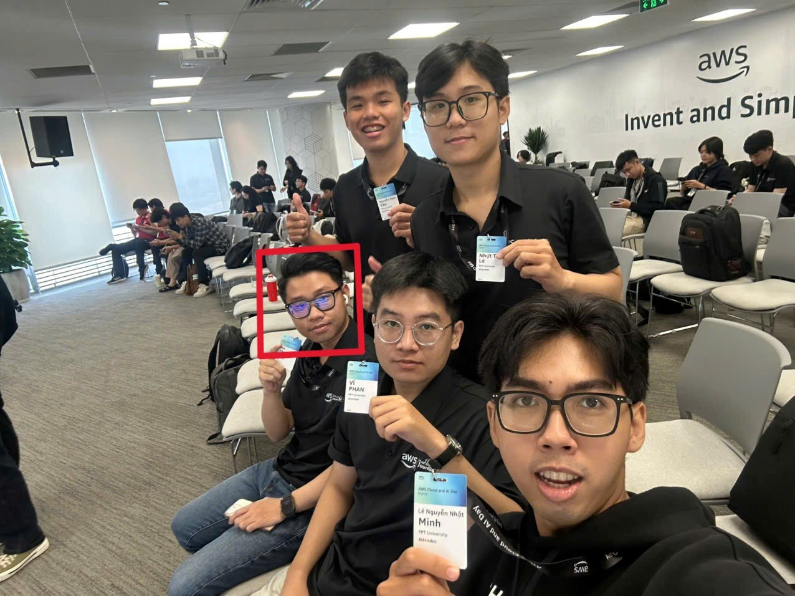

# Bài thu hoạch "AWS Cloud and AI Day Hanoi 2026"

### Thông Tin Sự Kiện

- **Tên sự kiện:** AWS Cloud and AI Day Hanoi 2026
- **Thời gian:** Thứ Ba, 29/09/2026, 07:30 – 17:00 (UTC+7)
- **Địa điểm chính:** Khách sạn JW Marriott Hà Nội
- **Nơi em tham gia:** HCMC Watch Party – văn phòng AWS Việt Nam tại TP. Hồ Chí Minh (xem trực tiếp keynote và một số phiên)
- **Vai trò:** Người tham dự (Attendee)
- **Trang sự kiện:** <https://aws.amazon.com/vi/events/cloud-day-hanoi/>

### Mục Đích Của Sự Kiện

- Giới thiệu cách AWS giúp các builder biến ý tưởng thành sản phẩm thật bằng cloud và AI
- Giới thiệu **agentic AI** (AI agent có thể tự lên kế hoạch và thực hiện công việc) cho developer, hiện đại hóa workload và bảo mật
- Chia sẻ câu chuyện thực tế từ các doanh nghiệp Việt Nam
- Kết nối developer, lãnh đạo IT và cộng đồng AWS tại Việt Nam

### Diễn Giả Keynote

- **H.E. Jennifer Wicks** – Đại sứ Hoa Kỳ tại Việt Nam
- **Dr. Werner Vogels** – CTO, Amazon.com
- **Eric Yeo** – Country General Manager Malaysia, Vietnam, Indochina, AWS
- **Mai Le** – Director of Product Management, Katalon
- **Dr. Jens Lottner** – Tổng Giám đốc (CEO), Techcombank

### Các Phiên Em Đã Tham Gia

| Thời gian | Phiên | Cấp độ |
| --- | --- | --- |
| 09:00 | Keynote – *What does it take to solve problems everyone says are impossible?* (KEY001) | 200 |
| 11:00 | *Building software like never before with agentic AI* (DVT205 – HCMC Watch Party) | 300 |
| 11:00 (Hà Nội) | *Build an AI-ready data foundation* (ANT202) / *Migration at Scale with Agentic AI: AWS Transform and Beyond* (AIM302) | 200 / 300 |

### Nội Dung Nổi Bật

#### Keynote: biến những ý tưởng "không thể" thành có thể
- AWS trình bày cách các công cụ và nguồn lực của mình giúp builder vượt qua giới hạn, kèm trải nghiệm thực tế từ khách hàng như **Techcombank** và **Katalon**.
- Chủ đề lớn là **hệ thống agentic**: các AI agent hỗ trợ developer, giúp hiện đại hóa workload và bảo mật tổ chức.

#### Agentic AI trong phát triển phần mềm
- AI đang chuyển từ "gợi ý code" sang **agent có thể nhận một nhiệm vụ, tự lên các bước và thực hiện** (viết code, viết test, sửa lỗi).
- Vai trò của developer chuyển sang mô tả bài toán rõ ràng, review kết quả của agent và đưa ra quyết định cuối cùng.

#### Nền tảng dữ liệu sẵn sàng cho AI (AI-ready data foundation)
- Ứng dụng AI chỉ tốt khi dữ liệu tốt: dữ liệu cần được **thu thập, làm sạch, tổ chức và quản trị** trước khi đưa vào AI.
- Cloud cung cấp các dịch vụ được quản lý (managed services) để lưu trữ và phân tích dữ liệu, giúp đội ngũ tập trung vào việc khai thác dữ liệu thay vì vận hành hạ tầng.

#### Migration quy mô lớn với AWS Transform
- **AWS Transform** dùng agentic AI để tăng tốc việc di chuyển (migrate) và hiện đại hóa các hệ thống lớn, cũ — công việc vốn tốn rất nhiều thao tác thủ công.

### Bài Học Rút Ra

- AI đã là công cụ thực tế trong các doanh nghiệp Việt Nam, không chỉ là đề tài nghiên cứu.
- AI tốt bắt đầu từ **dữ liệu tốt** và một nền tảng cloud vững chắc (bảo mật, kiểm soát chi phí, giám sát).
- Là sinh viên ngành AI, em cần học **cả** AI lẫn cloud: model chỉ có giá trị khi được triển khai, giám sát và bảo mật trong một hệ thống thật.

### Ứng Dụng Vào Công Việc

- Áp dụng ý tưởng **luồng dữ liệu sẵn sàng cho AI** (upload → xử lý → lưu trữ → sử dụng) khi thiết kế Workshop cuối kỳ của nhóm.
- Ưu tiên các **dịch vụ AWS managed / serverless** để nhóm tập trung vào tính năng AI thay vì quản lý server.
- Dùng trợ lý AI viết code một cách cẩn thận: dùng để làm nhanh hơn nhưng luôn đọc và hiểu code được sinh ra.

### Trải Nghiệm Sự Kiện

Đây là sự kiện lớn đầu tiên của AWS mà em tham gia. Cùng các bạn thực tập sinh FCAJ xem keynote và các phiên tại HCMC Watch Party giúp em thấy rõ cách các công ty thật ở Việt Nam đang dùng cloud và AI. Nhiều thuật ngữ còn mới với em (agentic AI, data foundation, AWS Transform), nên em đã ghi lại để tìm hiểu thêm trong kỳ thực tập.

#### Ảnh check-in

*Em là người trong khung đỏ.*
