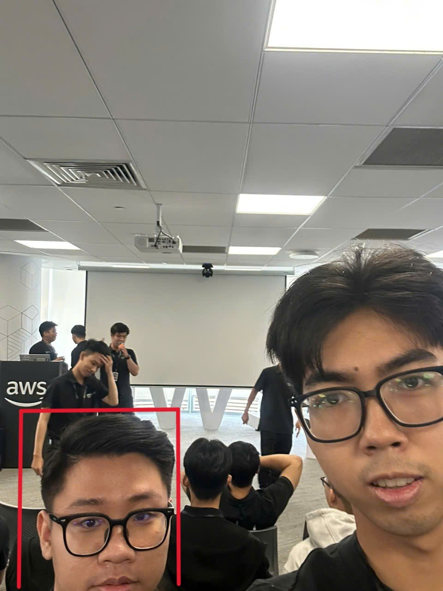

# Bài thu hoạch "FCAJ Community Day"

### Thông Tin Sự Kiện

- **Tên sự kiện:** FCAJ Community Day
- **Thời gian:** Thứ Bảy, 31/10/2026, 09:00 – 12:00
- **Địa điểm:** Văn phòng AWS Việt Nam, Bitexco Financial Tower, 2 Hải Triều, Phường Sài Gòn, TP. Hồ Chí Minh
- **Vai trò:** Người tham dự (Attendee)
- **Trang sự kiện:** <https://luma.com/1izeyind>

### Mục Đích Của Sự Kiện

- Chia sẻ kinh nghiệm thực tế khi xây dựng phần mềm và sử dụng dịch vụ AWS
- Giúp sinh viên hiểu ngành cloud cần gì và cần chuẩn bị ra sao
- Giới thiệu cách mới để xây dựng hệ thống serverless và bất đồng bộ trên AWS
- Khuyến khích thực tập sinh đóng góp mã nguồn mở và học hỏi từ cộng đồng

### Chương Trình

| Thời gian | Phiên |
| --- | --- |
| 09:00 – 09:25 | Lessons Learned from Building Software Factories |
| 09:30 – 09:55 | Education |
| 10:00 – 10:25 | AWS Lambda Web Functions: Rethinking Serverless Web Architecture |
| 10:30 – 11:00 | Amazon SQS: Building Asynchronous Systems |
| 11:00 – 11:25 | My 3-Month AWS Internship Journey |
| 11:30 – 12:00 | Start & Maintain Consistency with Open Source Contributing |

### Nội Dung Nổi Bật

#### Lessons Learned from Building Software Factories
- **Software factory** là một quy trình chuẩn, lặp lại được, giúp đội ngũ build, test và release phần mềm.
- Diễn giả chia sẻ các sai lầm thường gặp cần tránh và những gì thật sự hiệu quả khi xây dựng ở quy mô lớn.

#### Education
- Góc nhìn của nhà giáo dục về việc chuẩn bị nguồn nhân lực cloud thế hệ mới.
- Sinh viên cần chuẩn bị gì trước khi vào ngành, và cách thu hẹp khoảng cách giữa trường đại học với công việc thực tế.

#### AWS Lambda Web Functions: Rethinking Serverless Web Architecture
- Lambda giờ có thể phục vụ web request bằng **HTTP gốc (native HTTP)** và xử lý **tối đa 128 request cùng lúc** trong một function, thay đổi cách nghĩ về ứng dụng web serverless.
- Không cần lớp adapter trung gian, và **Active CPU Billing** (chỉ trả tiền cho thời gian CPU thật sự làm việc) giúp giảm chi phí.
- Phiên so sánh serverless với **Docker trên EC2/ECS** bằng benchmark (đo hiệu năng) thực tế.

#### Amazon SQS: Building Asynchronous Systems
- Hệ thống hiện đại cần **xử lý bất đồng bộ** (công việc được đưa vào hàng đợi và xử lý sau) để một phần chạy chậm không làm nghẽn cả hệ thống.
- **Amazon SQS** (hàng đợi tin nhắn được quản lý) giúp **tách rời (decouple)** các thành phần và mở rộng từng phần độc lập.
- Các mẫu thiết kế và mẹo thực tế, ví dụ dùng **Dead-Letter Queue (DLQ)** để giữ lại các tin nhắn bị lỗi nhiều lần.

#### My 3-Month AWS Internship Journey
- Một bạn thực tập sinh khóa trước chia sẻ cách áp dụng dịch vụ AWS vào dự án thực tế trong 3 tháng.
- Bài học và lời khuyên cho những bạn mới bắt đầu thực tập.

#### Start & Maintain Consistency with Open Source Contributing
- Cách đóng góp mã nguồn mở lần đầu từ con số 0.
- Cách xây dựng thói quen đóng góp đều đặn, giữ động lực, và lợi ích cho kỹ năng lẫn sự nghiệp.

### Bài Học Rút Ra

- Serverless không còn chỉ dành cho các function nhỏ; nó có thể là lựa chọn thật cho ứng dụng web, nhưng nên quyết định dựa trên **dữ liệu chi phí và hiệu năng**, không theo thói quen.
- Đặt **hàng đợi (SQS)** giữa các bước giúp hệ thống tin cậy hơn: nếu một bước lỗi, tin nhắn nằm chờ trong hàng đợi thay vì bị mất.
- Kỳ thực tập rất ngắn. Học đều mỗi ngày và làm một dự án thật quan trọng hơn đọc thật nhiều lý thuyết.

### Ứng Dụng Vào Công Việc

- Cân nhắc thêm **Amazon SQS** giữa bước upload và bước xử lý (Lambda) trong Workshop cuối kỳ của nhóm, kèm DLQ cho các tác vụ lỗi.
- Khi chọn giữa Lambda và container cho workshop, so sánh chi phí bằng **AWS Pricing Calculator** trước khi quyết định.
- Làm theo lời khuyên từ phiên chia sẻ thực tập: cập nhật worklog trung thực mỗi tuần và thực hành lab thay vì chỉ đọc.

### Trải Nghiệm Sự Kiện

Sự kiện này rất gần với hoàn cảnh của em khi đang thực tập. Phần chia sẻ của bạn thực tập sinh khóa trước giúp em thấy rõ 3 tháng thực tập có thể đạt được những gì, còn hai phiên về Lambda và SQS liên quan trực tiếp tới các dịch vụ nhóm em có thể dùng trong workshop. Em cũng nhận ra đóng góp mã nguồn mở là việc có thể bắt đầu từ những bước nhỏ.

#### Ảnh check-in

*Em là người trong khung đỏ.*
