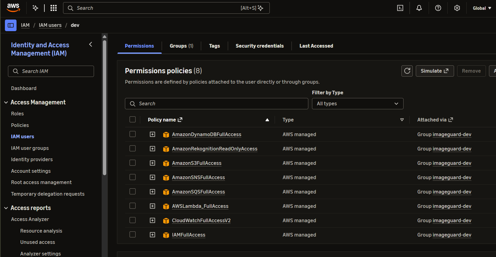

## Tài khoản và quyền

1. Một tài khoản AWS có **AWS Budgets** cảnh báo khi chi phí vượt 10 USD.
2. **Không dùng tài khoản root.** Root chỉ dùng để bật MFA rồi cất đi, không tạo access key.
3. Tạo IAM user có **MFA**, thêm vào 2 group (mỗi group tối đa 10 managed policy):

| Group | Managed policy |
|---|---|
| `imageguard-dev` | `AmazonS3FullAccess`, `AmazonDynamoDBFullAccess`, `AmazonSNSFullAccess`, `AmazonSQSFullAccess`, `AWSLambda_FullAccess`, `IAMFullAccess`, `CloudWatchFullAccessV2`, `AmazonRekognitionReadOnlyAccess`, `AWSCloudShellFullAccess` |
| `imageguard-dev-2` | `AmazonCognitoPowerUser`, `AmazonAPIGatewayAdministrator`, `CloudFrontFullAccess` |

*Hình: Group IAM với các policy*

{}
`IAMFullAccess` cho phép tự cấp thêm quyền (privilege escalation). Trong workshop chấp nhận được vì user phải tạo role cho Lambda; môi trường production nên giới hạn bằng **permission boundary**.
{}

## Region và công cụ

- Region: **US East (N. Virginia) – us-east-1**. Kiểm tra góc phải Console trước mỗi bước.
- Trình duyệt và AWS Console. Step 3–4 có thể chạy bằng **AWS CloudShell** (có sẵn AWS CLI), không cần cài gì trên máy.
- Ghi lại **Account ID** (12 số, không có dấu gạch ngang). Trong hướng dẫn, thay `<ACCOUNT_ID>` bằng số này.

## Ảnh thử nghiệm

Chuẩn bị 2–3 ảnh **JPEG** dưới 5 MB:
- 1 ảnh bình thường, ví dụ chai bia (Rekognition gắn nhãn *Alcohol* nhưng chính sách vẫn cho qua).
- 1 ảnh súng đồ chơi bằng gỗ (bị nhận là *Violence/Weapons* ~97% → ví dụ **false positive** cho phần kiểm thử).

## Kiểm tra quota

Rekognition không cần xin quota cho mức thử nghiệm. Thử nhanh trên Console: **Rekognition → Content moderation → Upload** một ảnh bất kỳ; nếu ra kết quả là tài khoản dùng được.
