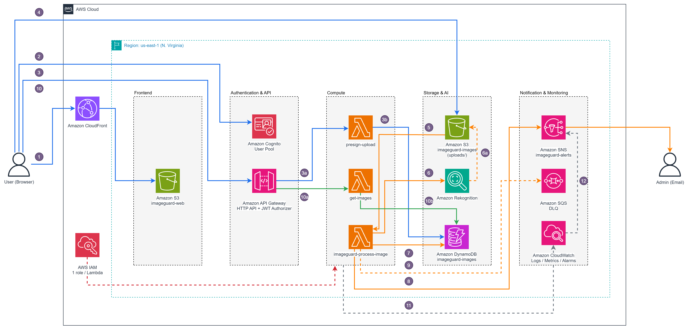

## Luồng xử lý

| # | Bước |
|---|---|
| 1 | Người dùng mở web qua **CloudFront**; CloudFront đọc bucket web private bằng **OAC** |
| 2 | Đăng nhập **Cognito Managed Login** (Authorization Code + PKCE) → nhận JWT |
| 3 | `POST /upload-url` qua **API Gateway** (JWT Authorizer) → Lambda `presign-upload` tạo item `PENDING` trong DynamoDB và trả presigned URL (5 phút) |
| 4 | Trình duyệt `PUT` ảnh thẳng lên S3: `uploads/{sub}/{uuid}.jpg` |
| 5 | **S3 Event** `ObjectCreated:Put` (prefix `uploads/`, suffix `.jpg`) gọi Lambda `process-image` bất đồng bộ |
| 6 | `DetectModerationLabels` (ngưỡng 60%). Nếu không thuộc danh mục bị chặn → `DetectLabels` (10 nhãn, ≥ 80%) |
| 7 | `UpdateItem` có điều kiện `status = PENDING` → `APPROVED` / `REJECTED` |
| 8 | Nếu `REJECTED` và DB đã cập nhật → **SNS** gửi email quản trị viên |
| 9 | Lỗi sau 2 lần retry → **SQS DLQ** (giữ 14 ngày) |
| 10 | `GET /images` → Lambda `get-images` `Query` theo `userId = sub`; chỉ ảnh `APPROVED` có presigned GET URL |
| 11–12 | Log + metric EMF → **CloudWatch**; Alarm → SNS |

## Chính sách kiểm duyệt

- Chặn danh mục cấp 1: **Explicit, Violence, Visually Disturbing, Drugs & Tobacco, Hate Symbols** (biến môi trường `BLOCKED_CATEGORIES`, đổi không cần sửa code).
- Cho qua **Alcohol** nhưng vẫn lưu nhãn để quản trị viên tra cứu.
- Kiểm duyệt trước, gắn nhãn sau: ảnh vi phạm không tốn thêm lượt `DetectLabels`.

## Thiết kế bảo mật

| Nguyên tắc | Cách làm |
|---|---|
| Least privilege | Mỗi Lambda 1 IAM role riêng, không dùng `AWSLambdaBasicExecutionRole` |
| Dữ liệu riêng tư | 2 bucket đều **Block all public access**, ACL disabled, SSE-S3, bucket policy bắt HTTPS |
| Xác thực | JWT Authorizer kiểm tra issuer (User Pool) và audience (App client); `userId` luôn lấy từ claim `sub`, không nhận từ body |
| Upload an toàn | Presigned URL do server ký, chỉ PUT được 1 key do server đặt, hết hạn 5 phút, bắt buộc `image/jpeg` |
| Chống confused deputy | Resource-based policy của Lambda có `aws:SourceArn` + `aws:SourceAccount` |
| Chống recursive trigger | Trigger chỉ prefix `uploads/`, `process-image` không có quyền ghi S3 |
| Idempotent | `UpdateItem` điều kiện `status = PENDING`: sự kiện trùng hoặc upload đè không đổi được kết quả |
| Web | CloudFront OAC, HTTPS, SecurityHeadersPolicy (HSTS, X-Frame-Options…), frontend chỉ dùng `textContent` để tránh XSS |

### Quyền của từng Lambda

| Lambda | Được phép | Không có |
|---|---|---|
| `process-image` | `s3:GetObject` (uploads/*), 2 action Rekognition, `dynamodb:UpdateItem`, `sns:Publish`, `sqs:SendMessage`, log của chính nó | PutObject, Query, PutItem |
| `presign-upload` | `s3:PutObject` (uploads/*), `dynamodb:PutItem`, log | GetObject, Query, UpdateItem |
| `get-images` | `dynamodb:Query`, `s3:GetObject` (uploads/*), log | PutObject, PutItem |

Rekognition dùng `Resource: "*"` vì `DetectModerationLabels` / `DetectLabels` không hỗ trợ resource-level permission; bù lại chỉ cấp đúng 2 action.

## Vì sao không dùng VPC?

Không có cơ sở dữ liệu hay máy chủ nào cần mạng riêng. Lambda gọi các dịch vụ AWS qua HTTPS và được xác thực bằng IAM. Đưa Lambda vào VPC sẽ tốn thêm NAT Gateway hoặc VPC Endpoint (vài chục USD/tháng) mà không tăng bảo mật đáng kể.
