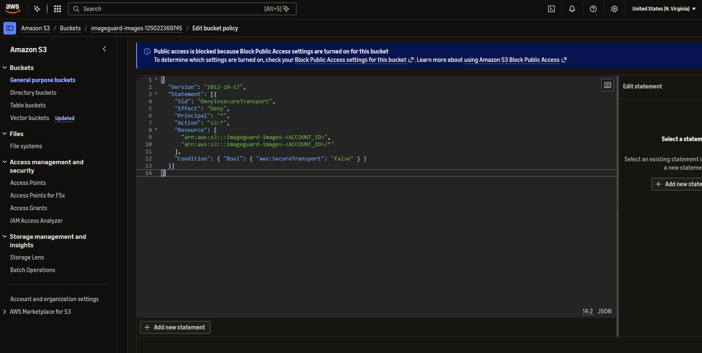
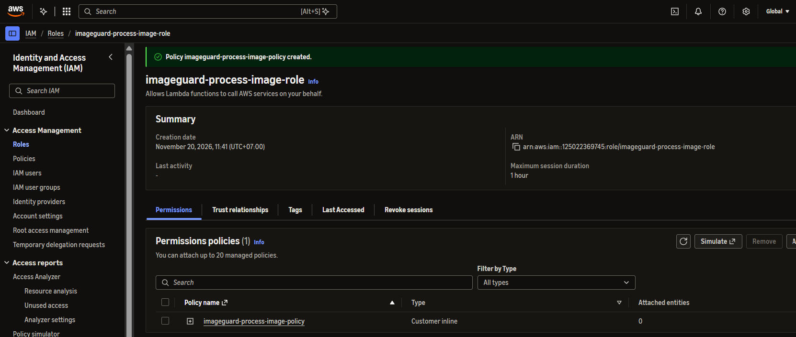
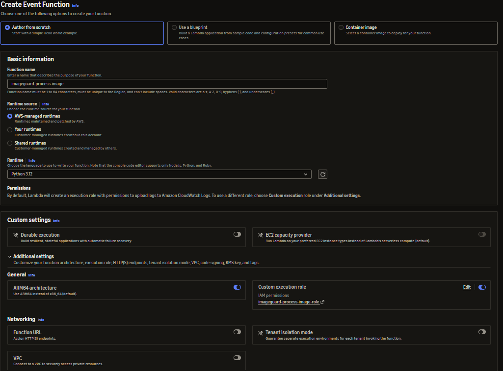
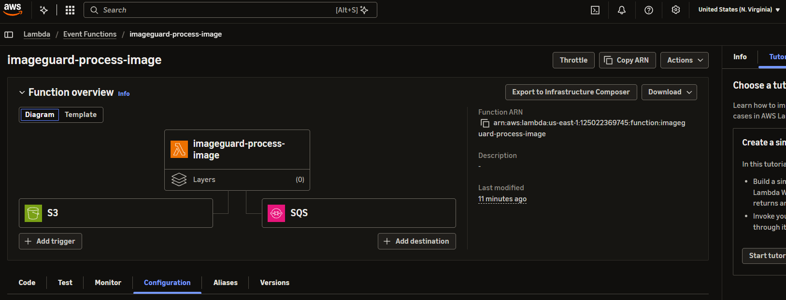
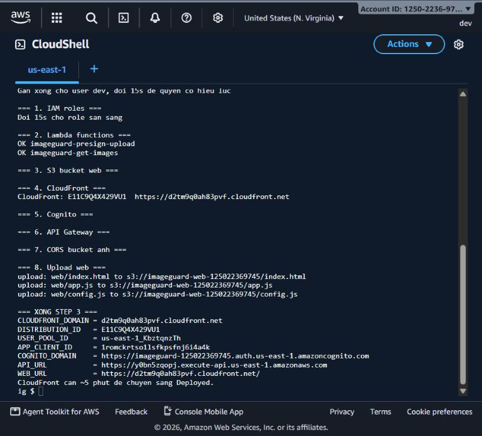
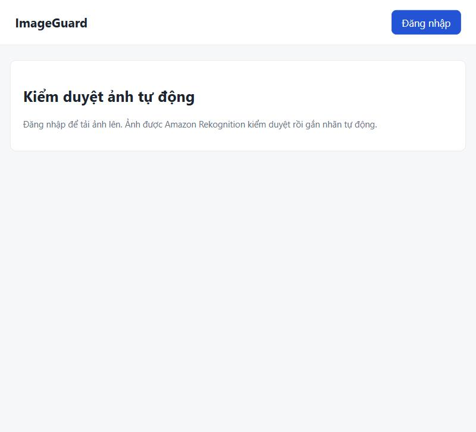
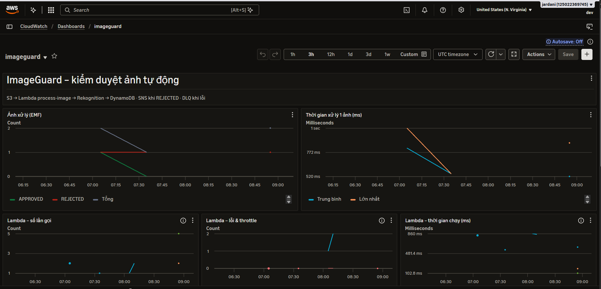

Mã nguồn đầy đủ: [static/code/imageguard](https://github.com/Pham-Nhut-An/fcj-workshop/tree/main/static/code/imageguard). Thay `<ACCOUNT_ID>` bằng Account ID của bạn (12 số liền).

## Step 1 – Tài nguyên nền tảng

### 1.1. S3 bucket ảnh
**S3 → Create bucket** → `imageguard-images-<ACCOUNT_ID>` · ACLs disabled · **Block all public access** · Versioning Disable · **SSE-S3**.

- **Management → Lifecycle rule** `delete-uploads-30d`: prefix `uploads/`, xóa sau **30 ngày**.
- **Permissions → Bucket policy**: từ chối mọi request không dùng HTTPS (`aws:SecureTransport = false`).



### 1.2. DynamoDB
**Create table** `imageguard-images` · Partition key `userId` (String) · Sort key `imageId` (String) · **On-demand**.

### 1.3. SNS và SQS
- SNS **Standard** topic `imageguard-alerts`, **Encryption tắt** (xem [Xử lý sự cố](../5.5-testing/)), subscription Email → bấm **Confirm subscription** trong email.
- SQS **Standard** `imageguard-process-dlq`, retention **14 ngày**, SSE-SQS mặc định.

### 1.4. IAM role cho `process-image`
**IAM → Roles → Create role** → AWS service **Lambda** → **không gắn managed policy nào** → `imageguard-process-image-role` → **Create inline policy** (JSON):

```json
{
  "Version": "2012-10-17",
  "Statement": [
    {"Sid": "ReadUploadedImages", "Effect": "Allow", "Action": "s3:GetObject", "Resource": "arn:aws:s3:::imageguard-images-<ACCOUNT_ID>/uploads/*"},
    {"Sid": "AnalyzeImagesWithRekognition", "Effect": "Allow", "Action": ["rekognition:DetectModerationLabels", "rekognition:DetectLabels"], "Resource": "*"},
    {"Sid": "UpdateImageResults", "Effect": "Allow", "Action": "dynamodb:UpdateItem", "Resource": "arn:aws:dynamodb:us-east-1:<ACCOUNT_ID>:table/imageguard-images"},
    {"Sid": "SendModerationAlerts", "Effect": "Allow", "Action": "sns:Publish", "Resource": "arn:aws:sns:us-east-1:<ACCOUNT_ID>:imageguard-alerts"},
    {"Sid": "SendFailedEventsToDLQ", "Effect": "Allow", "Action": "sqs:SendMessage", "Resource": "arn:aws:sqs:us-east-1:<ACCOUNT_ID>:imageguard-process-dlq"},
    {"Sid": "WriteOwnLogsOnly", "Effect": "Allow", "Action": ["logs:CreateLogGroup", "logs:CreateLogStream", "logs:PutLogEvents"], "Resource": ["arn:aws:logs:us-east-1:<ACCOUNT_ID>:log-group:/aws/lambda/imageguard-process-image", "arn:aws:logs:us-east-1:<ACCOUNT_ID>:log-group:/aws/lambda/imageguard-process-image:*"]}
  ]
}
```

Trang Review phải hiện đủ **6 service**. Nếu báo *"The policy failed legacy parsing"* thì kiểm tra lại Account ID (xem mục 5.5).



## Step 2 – Lambda `process-image` và S3 Event

### 2.1. Tạo function
**Lambda → Create function → Author from scratch** · tên `imageguard-process-image` · **Python 3.12** · **Additional settings**: ARM64 **bật**, Custom execution role **bật** → `imageguard-process-image-role`, Function URL **tắt**.



Dán `process_image/lambda_function.py` → **Deploy**. Memory **256 MB**, Timeout **30 giây**.

| Biến môi trường | Giá trị |
|---|---|
| `TABLE_NAME` | `imageguard-images` |
| `BUCKET_NAME` | `imageguard-images-<ACCOUNT_ID>` |
| `TOPIC_ARN` | `arn:aws:sns:us-east-1:<ACCOUNT_ID>:imageguard-alerts` |
| `BLOCKED_CATEGORIES` | `Explicit,Violence,Visually Disturbing,Drugs & Tobacco,Hate Symbols` |
| `MIN_MODERATION_CONFIDENCE` | `60` |
| `MAX_LABELS` · `MIN_LABEL_CONFIDENCE` | `10` · `80` |

### 2.2. Ý chính trong code

```python
# Retry co exponential backoff cho throttling / 5xx
BOTO_CONFIG = Config(retries={"max_attempts": 5, "mode": "standard"})

# Chi nhan key dung dinh dang -> chan key la, path traversal
KEY_PATTERN = re.compile(r"^uploads/([A-Za-z0-9-]{1,64})/([A-Za-z0-9-]{1,64})\.(jpg|jpeg|png)$")

# UpdateItem co dieu kien: item phai ton tai va dang PENDING
ConditionExpression="attribute_exists(#uid) AND #st = :pending"

# Chi gui SNS khi DB da cap nhat thanh cong
if blocked and updated:
    publish_alert(user_id, image_id, key, blocked)
```

Metric được ghi bằng **Embedded Metric Format**: in một dòng JSON có khóa `_aws` ra log, CloudWatch tự tạo metric `ImagesProcessed`, `ImagesApproved`, `ImagesRejected`, `ProcessingLatency`, `AlertPublishFailed` (namespace `ImageGuard`). Không cần quyền `cloudwatch:PutMetricData`.

### 2.3. Retry, DLQ và trigger
- **Configuration → Asynchronous invocation**: Maximum age 1 giờ, Retry attempts **2**.
- **Destinations → On failure** → SQS `imageguard-process-dlq`.
- **Add trigger → S3**: bucket ảnh, event **PUT**, prefix `uploads/`, suffix `.jpg`.



## Step 3 – Cognito, API Gateway, web tĩnh

Step 3 có thể làm trên Console theo thứ tự bên dưới, hoặc chạy script [`setup.sh`](https://github.com/Pham-Nhut-An/fcj-workshop/tree/main/static/code/imageguard/scripts/setup.sh) trong **CloudShell** để tạo toàn bộ bằng AWS CLI (khoảng 3 phút).



### 3.1. Hai Lambda cho API
Tạo 2 role riêng (least privilege) rồi 2 function Python 3.12 arm64, 128 MB, 10 giây:

| Lambda | Quyền inline policy | Biến môi trường |
|---|---|---|
| `imageguard-presign-upload` | `s3:PutObject` (uploads/*), `dynamodb:PutItem`, log | `BUCKET_NAME`, `TABLE_NAME`, `URL_EXPIRES_SECONDS=300` |
| `imageguard-get-images` | `dynamodb:Query`, `s3:GetObject` (uploads/*), log | `BUCKET_NAME`, `TABLE_NAME`, `URL_EXPIRES_SECONDS=300`, `MAX_ITEMS=50` |

`presign-upload` lấy `userId` từ `requestContext.authorizer.jwt.claims.sub`, tự sinh `imageId` (UUID), tạo item `PENDING` rồi ký presigned PUT URL. Presigned URL được ký bằng quyền của Lambda, nên role phải có `s3:PutObject`.

### 3.2. Web tĩnh + CloudFront
1. Bucket `imageguard-web-<ACCOUNT_ID>` (private, SSE-S3), upload `index.html`, `app.js`, `config.js`.
2. **CloudFront → Create distribution**: origin S3 bucket web với **OAC**, Redirect HTTP to HTTPS, CachingOptimized, Response headers **SecurityHeadersPolicy**, Default root object `index.html`, WAF không bật.
3. Bucket policy chỉ cho `cloudfront.amazonaws.com` với `AWS:SourceArn` = ARN distribution.



### 3.3. Cognito
User pool `imageguard-users`, đăng nhập bằng **email**, cho tự đăng ký. App client **SPA, không có client secret**: Authorization code grant, scope `openid email`, callback và sign-out URL = `https://<CLOUDFRONT_DOMAIN>/`. Tạo domain (Managed login).


### 3.4. API Gateway HTTP API
- Routes `POST /upload-url` → `presign-upload`, `GET /images` → `get-images`, stage `$default` auto-deploy.
- **JWT Authorizer** `cognito-jwt`: issuer `https://cognito-idp.us-east-1.amazonaws.com/<USER_POOL_ID>`, audience `<APP_CLIENT_ID>`, gắn cho cả 2 route.
- **CORS**: chỉ origin `https://<CLOUDFRONT_DOMAIN>`, header `authorization, content-type`, method `GET, POST, OPTIONS`.
- **Throttling** default route: rate 10, burst 20.

### 3.5. Nối các phần
- CORS cho bucket ảnh: cho phép `PUT, GET` từ domain CloudFront.
- Điền `config.js` (Cognito domain, client ID, redirect URI, API URL), upload lại, tạo CloudFront invalidation `/*`.

## Step 4 – Giám sát

Chạy [`step4.sh`](https://github.com/Pham-Nhut-An/fcj-workshop/tree/main/static/code/imageguard/scripts/step4.sh) trong CloudShell, hoặc tạo trên Console:

| Alarm | Metric | Ngưỡng (5 phút) |
|---|---|---|
| `imageguard-{process-image,presign-upload,get-images}-errors` | AWS/Lambda Errors | ≥ 1 |
| `imageguard-process-image-throttles` | AWS/Lambda Throttles | ≥ 1 |
| `imageguard-dlq-not-empty` | AWS/SQS ApproximateNumberOfMessagesVisible | ≥ 1 |
| `imageguard-alert-publish-failed` | ImageGuard AlertPublishFailed | ≥ 1 |
| `imageguard-api-5xx` | AWS/ApiGateway 5xx | ≥ 5 |

Mọi alarm gửi thông báo cả khi chuyển **ALARM** và **OK** tới SNS `imageguard-alerts`. Dashboard `imageguard` gồm số ảnh APPROVED/REJECTED, thời gian xử lý, Lambda, API Gateway, DLQ và trạng thái alarm. Log retention **14 ngày** cho cả 3 Lambda.


