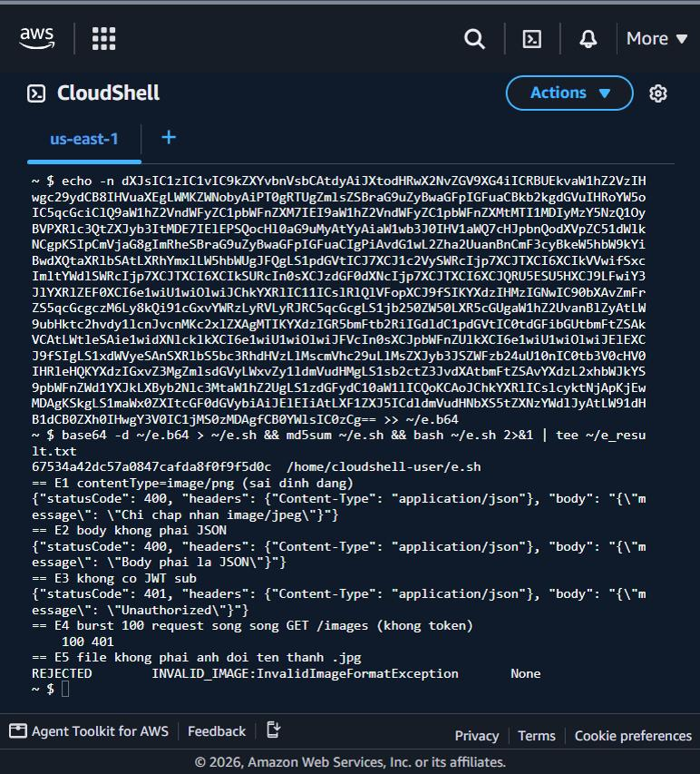

## Functional tests

| Test | How | Result |
|---|---|---|
| Valid image | Upload a beer image via the website | `APPROVED`, labels Alcohol · Beer · Bottle…, shown in the gallery |
| Violating image | Upload the wooden toy gun | `REJECTED`, `blockedCategories = Violence`, the admin gets an email |
| Real user | Check DynamoDB | `userId` is the Cognito `sub` UUID, not an email |
| Idempotency | Overwrite the same key | Log `item_missing_or_already_processed`, status unchanged |
| Unknown key | Upload a file with no PENDING item | No new item, no email |
| DLQ | Set a wrong `TABLE_NAME`, invoke asynchronously | After 2 retries the DLQ holds a `RetriesExhausted` message, `approximateInvokeCount: 3` |

{}
**False positive:** a wooden toy gun is detected as *Violence/Weapons* with ~97% confidence. Improvements: raise `MIN_MODERATION_CONFIDENCE` for specific categories, or add an admin review step for `REJECTED` images.
{}

The DLQ test also proves **least privilege**: the error in the DLQ is `AccessDeniedException … not authorized to perform: dynamodb:UpdateItem on resource: …table/khong-ton-tai`. IAM blocks it immediately because the role can only write to `imageguard-images`.

## Success criteria check (Proposal section 3.2)

| Criterion | Target | Measured result |
|---|---|---|
| Processing time per image | ≤ 10 seconds | ✅ About 0.5–1 second (`ProcessingLatency` metric on the dashboard) |
| Violating images blocked | ≥ 90% | ❌ 2/3 (67%): both gun images blocked, one smoking image missed |
| Valid images blocked by mistake | ≤ 10% | ❌ 1/8 (12.5%): a wooden toy gun was blocked (Violence/Weapons 98%); a toy water gun was approved |
| API call without sign-in | Rejected (401) | ✅ `{"message":"Unauthorized"}` |
| User A sees user B's images | Impossible | ✅ The real user's gallery shows only their own images although the table also holds `test-user-001` items (`Query` by `sub`) |
| Violating image detected | Admin email | ✅ |
| Direct access to the S3 bucket | Blocked | ✅ 403 AccessDenied |

Both rates are measured on **12 images**: the 2 initial test images plus 10 images from Wikimedia Commons, run through the real pipeline with the [`batch_test.sh`](/fcj-workshop/code/imageguard/scripts/batch_test.sh) script (26/11/2026).

| Group | Image | Expected | Result | Labels / categories |
|---|---|---|---|---|
| Normal | Laptop on a desk | APPROVED | ✅ APPROVED | Furniture, Table, Desk, Computer |
| Normal | Bicycle | APPROVED | ✅ APPROVED | Wheel, Bicycle, Transportation |
| Normal | Pizza | APPROVED | ✅ APPROVED | Food, Meal, Pizza |
| Normal | Cat | APPROVED | ✅ APPROVED | Animal, Abyssinian, Cat |
| Alcohol | Beer bottle | APPROVED (Alcohol allowed) | ✅ APPROVED | Alcohol, Beer, Bottle |
| Tobacco | Man smoking, holding a pickaxe | REJECTED | ❌ APPROVED | Moderation only found `Smoking` at 27% (< 60% threshold); DetectLabels mistook the pickaxe for a `Rifle` |
| Weapons | Handgun | REJECTED | ✅ REJECTED | Violence → Weapons |
| Weapons | Soldier with a rifle | REJECTED | ✅ REJECTED | Violence → Weapons, Weapon Violence |
| Tricky | Toy water gun | APPROVED | ✅ APPROVED | Toy, Water Gun |
| Tricky | Halloween fake-blood makeup | Policy dependent | REJECTED | Violence → Blood & Gore (not counted in either rate) |

**Findings and improvements:**
- The 60% threshold catches obvious weapons but misses smoking when the cigarette is small in the frame. Per-category thresholds (for example 25% for `Drugs & Tobacco`) would help, at the cost of more false positives.
- Gun-shaped toys are sometimes blocked, sometimes not, and fake blood counts as Blood & Gore. These cases call for an admin review step for `REJECTED` images instead of a hard block.
- 12 images is still a small sample: the results show a trend, not statistical accuracy.

## Security tests

| Test | Expected | Actual |
|---|---|---|
| `GET /images` without a token | 401 Unauthorized | ✅ `{"message":"Unauthorized"}` |
| Open a web-bucket file directly | 403 AccessDenied | ✅ only CloudFront can read it (OAC) |
| Open an image Object URL directly | 403 AccessDenied | ✅ |
| Open a presigned URL after 6 minutes | Request has expired | ✅ 200 before expiry, 403 after |
| `http://` | Redirects to `https://` | ✅ `301 Moved Permanently` |
| Response headers | HSTS, X-Frame-Options, X-Content-Type-Options, Referrer-Policy | ✅ |
| Sign-in | URL contains `code_challenge_method=S256` (PKCE) | ✅ |

The site is served from CloudFront's **SGN (Ho Chi Minh City)** edge, so Vietnamese users get fast loads even though the backend runs in us-east-1.

## Error-case tests

Run the [`error_test.sh`](/fcj-workshop/code/imageguard/scripts/error_test.sh) script in CloudShell (28/11/2026). Tests E1–E3 invoke the `imageguard-presign-upload` Lambda directly with `aws lambda invoke` and bad input; E4 sends 100 parallel requests to the API; E5 uploads a text file renamed to `.jpg`.

| # | Scenario | Expected | Actual result |
|---|---|---|---|
| E1 | Request an upload URL with `contentType: image/png` | Rejected with 400 | ✅ `400` – "Chi chap nhan image/jpeg" (JPEG only) |
| E2 | Body is not JSON | Rejected with 400 | ✅ `400` – "Body phai la JSON" (body must be JSON) |
| E3 | No JWT (missing `sub`) | Rejected with 401 | ✅ `401` – "Unauthorized" |
| E4 | 100 parallel `GET /images` requests without a token | Blocked before reaching Lambda | ✅ 100/100 returned `401` at the JWT Authorizer; Lambda was never invoked, so no cost. The 10 requests/second limit (burst 20) was not triggered in this test; not yet tested with authenticated requests |
| E5 | Text file renamed to `.jpg` | Not stuck in `PENDING`, Lambda does not crash | ✅ The item became `REJECTED` with reason `INVALID_IMAGE:InvalidImageFormatException`; the Lambda finished normally, so nothing went to the DLQ |

*Figure: `error_test.sh` output – E1, E2 return 400; E3 and E4 return 401; E5 the invalid image is marked REJECTED*

## Troubleshooting

### 1. Inline policy: "The policy failed legacy parsing"
**Cause:** a stray `>` after the Account ID in the DynamoDB ARN (`…:125022369745>:table/…`), so the Review page listed only 5 of 6 services.
**Fix:** the Account ID must be 12 digits with no dashes and no `<` `>`; use Find & Replace on `<ACCOUNT_ID>` before pasting.

### 2. Alert email arrived but the item stayed PENDING
**Cause:** at upload time the `img-002` item did not match, so the conditional `UpdateItem` was rejected; the first version of the code **published to SNS before** writing the DB, so the email still went out.
**Lesson:** that design let "unknown" uploads spam the admin. **Fixed:** publish to SNS only after the DB stores `REJECTED`; if SNS fails, log an ERROR and emit `AlertPublishFailed` so an alarm catches it.

*The alert email was sent…*

*…while the item was still PENDING*

### 3. Alarms sent no email
**Symptom:** the alarm went to ALARM but no email arrived; the alarm history said *"Failed to execute action"*.
**Cause:** the SNS topic was encrypted with the AWS managed key `alias/aws/sns`. CloudWatch Alarms cannot use that key (Lambda can, so REJECTED emails still arrived).
**Fix:** disable topic encryption → history shows *"Successfully executed action"*. If encryption is mandatory, use a customer managed KMS key whose key policy allows `cloudwatch.amazonaws.com` (~USD 1/month). The email only contains `userId`/`imageId`, no image or image link.

### 4. The Console differs from older docs
- New Lambda console: the role is under **Custom settings → Additional settings → Custom execution role**.
- New CloudWatch console: **Log groups** is now **Logs → Log Management**; Logs Insights is **Log Analytics**.
- A log stream shows only the last few lines: click **Load more** to see the `image_processed` line.

### 5. Amazon Bedrock was not available
The original idea used Amazon Nova Lite on Bedrock, but every team account had a quota of 0 and the increase request was denied. The team switched to **Amazon Rekognition**: no quota request needed, a ready-made moderation API, and per-image pricing that is easy to estimate.
