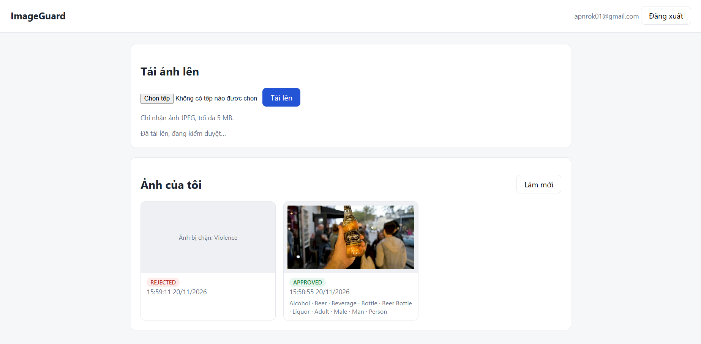
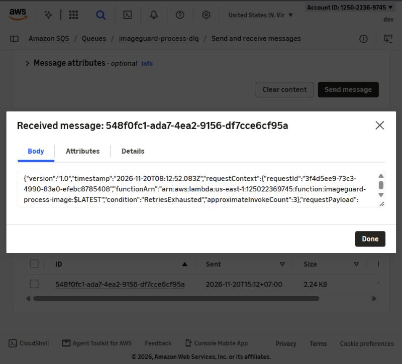
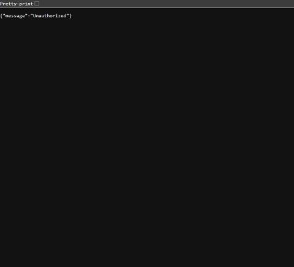
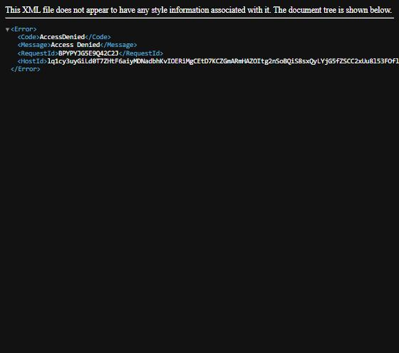
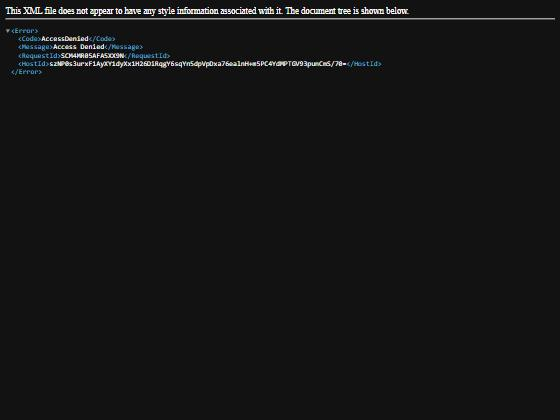
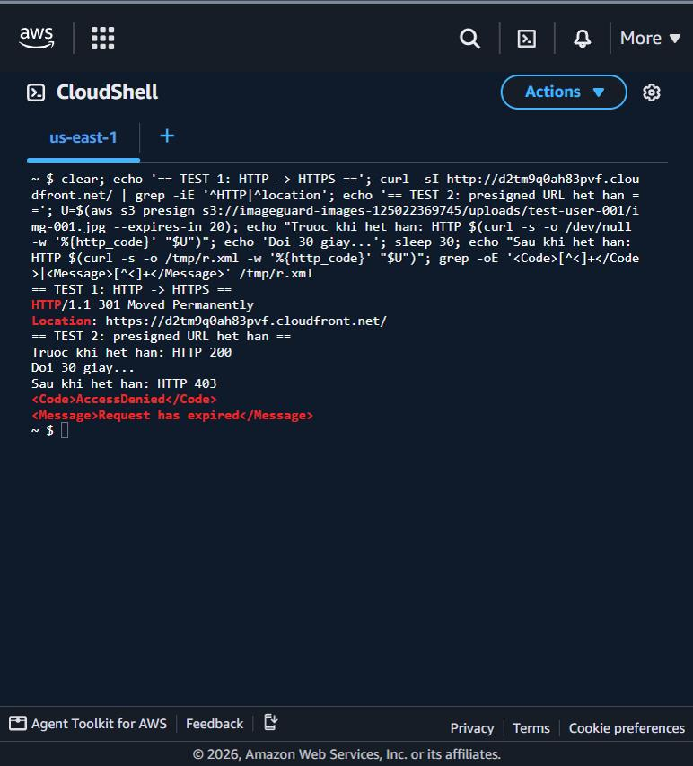
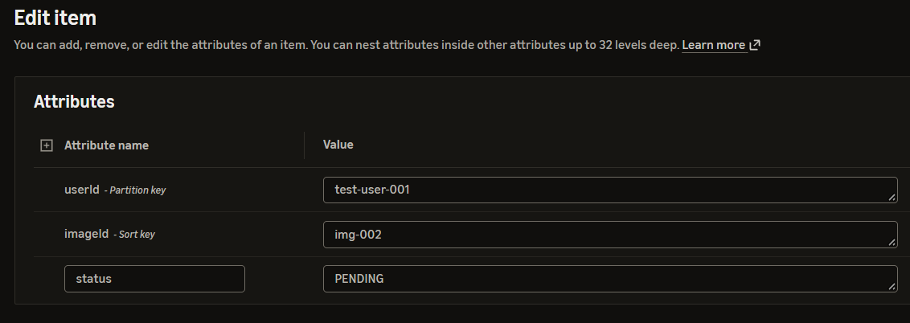
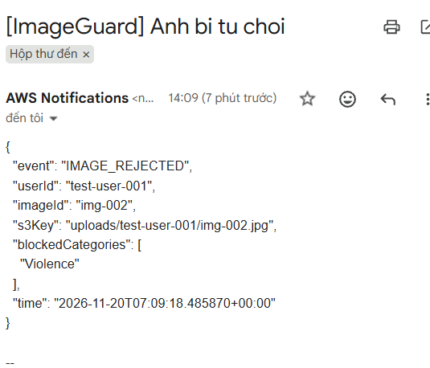
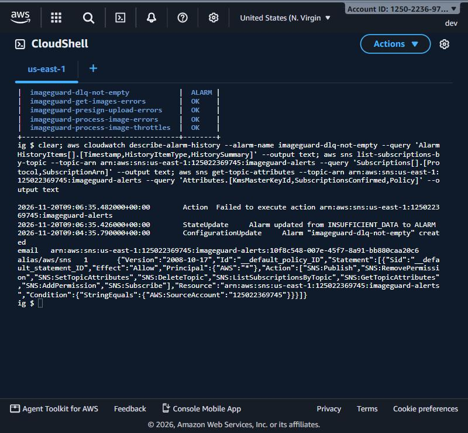
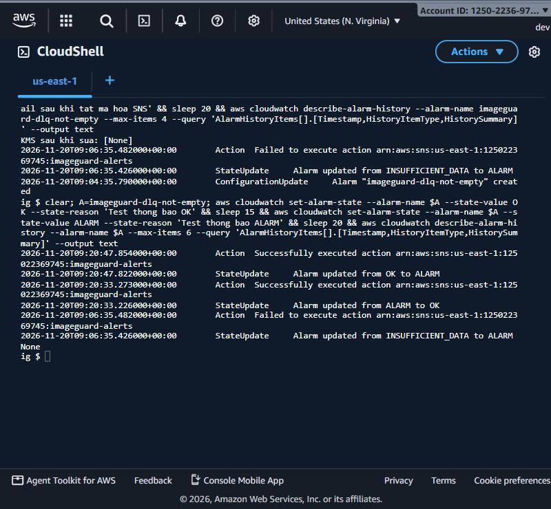

## Kiểm thử chức năng

| Test | Cách làm | Kết quả |
|---|---|---|
| Ảnh hợp lệ | Upload ảnh bia qua web | `APPROVED`, nhãn Alcohol · Beer · Bottle…, hiện ảnh trong gallery |
| Ảnh vi phạm | Upload ảnh súng gỗ | `REJECTED`, `blockedCategories = Violence`, admin nhận email |
| Người dùng thật | Xem DynamoDB | `userId` là UUID `sub` của Cognito, không phải email |
| Idempotent | Upload đè cùng key | Log `item_missing_or_already_processed`, trạng thái không đổi |
| Key lạ | Upload file không có item PENDING | Không tạo item mới, không gửi email |
| DLQ | Đổi `TABLE_NAME` sai rồi gọi Lambda bất đồng bộ | Sau 2 lần retry, DLQ có message `RetriesExhausted`, `approximateInvokeCount: 3` |

{}
**False positive:** súng đồ chơi bằng gỗ bị nhận là *Violence/Weapons* với độ tin cậy ~97%. Hướng cải thiện: tăng `MIN_MODERATION_CONFIDENCE` cho danh mục cụ thể, hoặc thêm bước quản trị viên duyệt lại ảnh `REJECTED`.
{}

Bài test DLQ còn cho thấy **least privilege** hoạt động: lỗi trong DLQ là `AccessDeniedException … not authorized to perform: dynamodb:UpdateItem on resource: …table/khong-ton-tai`. IAM chặn ngay vì role chỉ được ghi đúng bảng `imageguard-images`.

## Đối chiếu tiêu chí hoàn thành (Proposal mục 3.2)

| Tiêu chí | Mục tiêu | Kết quả đo |
|---|---|---|
| Thời gian xử lý 1 ảnh | ≤ 10 giây | ✅ Khoảng 0,5–1 giây (metric `ProcessingLatency` trên dashboard) |
| Ảnh vi phạm bị chặn đúng | ≥ 90% | ⚠️ Chưa đủ mẫu để kết luận: bộ ảnh thử nghiệm hiện chỉ có 2 ảnh |
| Ảnh hợp lệ bị chặn nhầm | ≤ 10% | ⚠️ 1/2 ảnh bị chặn nhầm (súng gỗ đồ chơi → Violence/Weapons 98%); mẫu quá nhỏ, cần bộ thử lớn hơn |
| Chưa đăng nhập gọi API | Bị từ chối (401) | ✅ `{"message":"Unauthorized"}` |
| Người dùng A xem ảnh của B | Không thể | ✅ Gallery của người dùng thật chỉ hiện ảnh của chính họ, dù bảng có cả item của `test-user-001` (`Query` theo `sub`) |
| Phát hiện ảnh vi phạm | Gửi email quản trị viên | ✅ |
| Truy cập trực tiếp bucket S3 | Bị chặn | ✅ 403 AccessDenied |

**Hạn chế:** tỉ lệ chặn đúng và chặn nhầm cần một bộ ảnh thử nghiệm lớn hơn (ví dụ 20–50 ảnh có gán nhãn đúng/sai) để đo chính xác. Ví dụ súng gỗ đồ chơi cho thấy cần thêm ngưỡng riêng cho từng danh mục hoặc bước quản trị viên duyệt lại ảnh `REJECTED`.

## Kiểm thử bảo mật

| Test | Kết quả mong đợi | Thực tế |
|---|---|---|
| Gọi `GET /images` không có token | 401 Unauthorized | ✅ `{"message":"Unauthorized"}` |
| Mở thẳng file trên bucket web | 403 AccessDenied | ✅ chỉ CloudFront đọc được (OAC) |
| Mở thẳng Object URL của ảnh | 403 AccessDenied | ✅ |
| Mở presigned URL sau 6 phút | Request has expired | ✅ 200 khi còn hạn, 403 sau khi hết hạn |
| `http://` | Tự chuyển `https://` | ✅ `301 Moved Permanently` |
| Response header | Có HSTS, X-Frame-Options, X-Content-Type-Options, Referrer-Policy | ✅ |
| Đăng nhập | URL có `code_challenge_method=S256` (PKCE) | ✅ |

Web được phục vụ từ edge **SGN (TP.HCM)** của CloudFront, nên người dùng Việt Nam vẫn tải nhanh dù backend ở us-east-1.

## Xử lý sự cố đã gặp

### 1. Inline policy báo "The policy failed legacy parsing"
**Nguyên nhân:** thừa dấu `>` sau Account ID trong ARN DynamoDB (`…:125022369745>:table/…`), nên trang Review chỉ hiện 5/6 service.
**Cách sửa:** Account ID phải là 12 số liền, không gạch ngang, không còn `<` `>`; dùng Find & Replace thay `<ACCOUNT_ID>` trước khi dán.

### 2. Có email cảnh báo nhưng item vẫn PENDING
**Nguyên nhân:** lúc upload, item `img-002` chưa khớp nên `UpdateItem` có điều kiện bị từ chối; bản code đầu **gửi SNS trước** khi ghi DB nên email vẫn đi.
**Bài học:** thiết kế cũ cho phép ảnh "lạ" spam email quản trị viên. **Đã sửa:** chỉ gửi SNS khi DB đã ghi `REJECTED`; nếu SNS lỗi thì ghi log ERROR + metric `AlertPublishFailed` để alarm bắt.

*Email cảnh báo vẫn được gửi…*

*…trong khi item vẫn ở trạng thái PENDING*

### 3. Alarm không gửi email
**Hiện tượng:** alarm chuyển ALARM nhưng không có email; lịch sử alarm ghi *"Failed to execute action"*.
**Nguyên nhân:** SNS topic bật mã hóa bằng key AWS quản lý `alias/aws/sns`. CloudWatch Alarm không dùng được key này (Lambda thì dùng được, nên email REJECTED vẫn tới).
**Cách sửa:** tắt mã hóa topic → lịch sử ghi *"Successfully executed action"*. Nếu bắt buộc mã hóa: dùng customer managed KMS key có key policy cho `cloudwatch.amazonaws.com` (~1 USD/tháng). Email chỉ chứa `userId`/`imageId`, không có ảnh hay link ảnh.

### 4. Giao diện Console khác tài liệu
- Lambda mới: role đặt ở **Custom settings → Additional settings → Custom execution role**.
- CloudWatch mới: **Log groups** đổi thành **Logs → Log Management**; Logs Insights thành **Log Analytics**.
- Trang log stream chỉ hiện vài dòng cuối: bấm **Load more** để thấy dòng `image_processed`.

### 5. Không dùng được Amazon Bedrock
Đề tài ban đầu dùng Amazon Nova Lite trên Bedrock, nhưng quota của mọi tài khoản trong nhóm bằng 0 và yêu cầu tăng quota bị từ chối. Nhóm chuyển sang **Amazon Rekognition**: không cần quota, có sẵn API kiểm duyệt nội dung, giá theo ảnh dễ dự toán.
