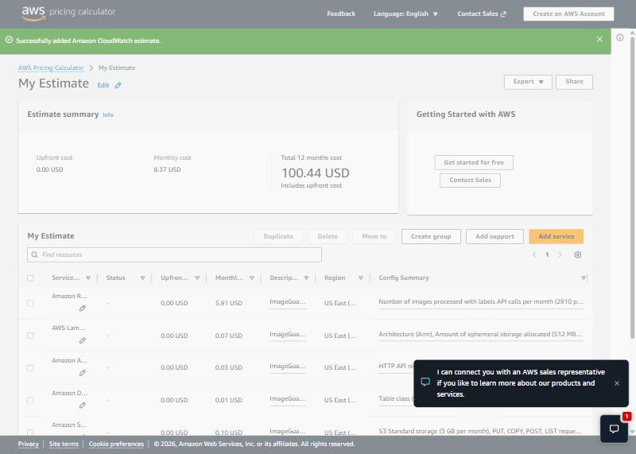

Dự toán bằng **AWS Pricing Calculator**: [xem estimate](https://calculator.aws/#/estimate?id=5fa9c30d042e143fc2fd1f9387af56c6709e22f9).

Giả định: us-east-1, **3.000 ảnh/tháng**, ảnh 1 MB, ~3% vi phạm, 30.000 lượt xem; giá on-demand, **chưa trừ Free Tier**.

| Dịch vụ | Cấu hình | USD/tháng |
|---|---|---|
| Amazon Rekognition | 3.000 `DetectModerationLabels` + 2.910 `DetectLabels` | 5,91 |
| AWS Lambda | 3 function arm64, 36.000 lượt, 500 ms, 256 MB | 0,07 |
| Amazon API Gateway (HTTP) | 33.000 request | 0,03 |
| Amazon DynamoDB (On-demand) | 6.000 write, 30.000 read, 0,01 GB | 0,01 |
| Amazon S3 | 3 GB, 3.000 PUT, 30.000 GET | 0,10 |
| Amazon CloudWatch | 5 metric EMF + 7 alarm + 0,1 GB log, 1 dashboard | 2,25 |
| CloudFront, Cognito, SNS, SQS | Trong mức miễn phí | 0,00 |
| **Tổng** | | **8,37** (≈ 100 USD/năm) |

**Chi phí thực tế khi làm workshop:** dưới 300 ảnh → Rekognition khoảng 0,30–0,60 USD; phần còn lại nằm trong Free Tier.

## Tối ưu chi phí

- 100% serverless: không có EC2, NAT Gateway hay tài nguyên chạy 24/7.
- Kiểm duyệt trước, gắn nhãn sau: ảnh vi phạm không gọi `DetectLabels`.
- Rekognition đọc ảnh thẳng từ S3 → Lambda chạy ngắn, ít bộ nhớ.
- Lambda **arm64** rẻ hơn x86 khoảng 20%.
- **HTTP API** rẻ hơn REST API khoảng 70%.
- S3 Lifecycle xóa ảnh sau 30 ngày; CloudWatch Logs retention 14 ngày.
- CloudWatch chiếm 27% tổng chi phí; với Free Tier (10 metric, 10 alarm, 3 dashboard) phần này gần bằng 0.
